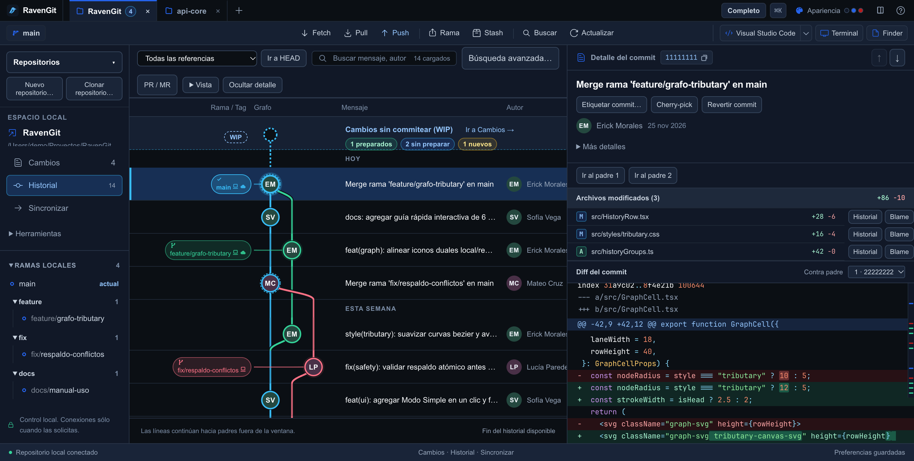

# RavenGit

[](CHANGELOG.md)
[](LICENSE)
[](https://v2.tauri.app)
[](https://react.dev)
[](https://www.rust-lang.org)
[](#requisitos-del-sistema)

**RavenGit** es un cliente Git de escritorio moderno, visual y de arquitectura **local-first**, diseñado para inspeccionar el historial, resolver conflictos y gestionar repositorios con total seguridad, rapidez y privacidad.

Construido sobre **Tauri 2**, **React 19** y un motor híbrido seguro en **Rust** (`gix` / *gitoxide* para lecturas locales de alta velocidad + Git CLI nativo para escrituras, hooks y remotos), RavenGit opera directamente sobre tus repositorios locales sin intermediarios ni telemetría.



---

## Características Principales

### 🌳 Historial Visual, Grafo Tributary y Navegación
- **Grafo estilo Tributary y Compacto:** vista **Tributary** por defecto con avatares circulares de autor, columna izquierda `Rama / Tag` redimensionable (`120–280 px`), iconos duales de sincronización local/remoto y separadores temporales (`Hoy`, `Esta semana`, `Anterior`), alternable al modo **Compacto (Puntos)** desde *Apariencia*.
- **Carga progresiva y fila WIP:** paginación continua con scroll infinito e indicador **Cambios sin commitear (WIP)** conectado directamente a `HEAD` mediante observador local en tiempo real.
- **Paleta de comandos y atajos:** acceso rápido a acciones y vistas mediante la paleta (`⌘K` / `Ctrl+K`) y guía interactiva de atajos (`?`).

### 🗂️ Multi-repositorio, Worktrees y Herramientas Externas
- **Pestañas multi-repositorio:** abre y alterna múltiples repositorios con sesiones, vistas y mutexes de escritura aislados en Rust.
- **Git Worktrees:** creación, bloqueo/desbloqueo, apertura en pestaña o carpeta, y limpieza de worktrees obsoletos.
- **Integración con herramientas locales:** detección y lanzamiento directo hacia editores, terminales y exploradores de archivos del sistema.

### 📝 Panel de Cambios, Diffs Avanzados y Visuales
- **Comparador de texto enriquecido:** visualización en modo **Unificado** o **Dividido (Side-by-side)** con resaltado de sintaxis, diferencias intra-línea, líneas de contexto configurables, opción para ignorar espacios en blanco y minimapa de cambios.
- **Staging y descarte granular:** prepara archivos enteros, bloques (*hunks*) o líneas específicas en transacciones atómicas de índice.
- **Diff visual de imágenes:** comparación de activos gráficos en modos lado a lado, cortina deslizable y superposición.
- **Commits, Amend y bloqueos:** creación de commits con detección de autor, soporte para `amend` con respaldo automático y protección clara ante archivos `index.lock`.

### 🔍 Búsqueda Profunda, Inspección y Rebase Interactivo
- **Búsqueda profunda y en código:** filtra en todo el historial del repositorio (mensaje, autor, fechas, ruta y expresiones regulares) o busca cambios en código fuente (`-S` / `-G`).
- **Archivo, Blame y Comparación de rango:** historial de archivo (`--follow`), **Git Blame** interactivo y comparación directa de rango entre dos commits (`Shift+Clic`).
- **Rebase interactivo visual:** reordenamiento y acciones `pick`, `reword`, `squash`, `fixup` y `drop` sobre secuencias lineales de 1 a 50 commits con respaldo previo.

### 🛡️ Seguridad 2.0, Snapshots y Recuperación
- **Snapshots locales:** capturas manuales y automáticas previas a operaciones críticas, con retención y límite de disco configurables.
- **Undo / Redo con vista previa:** deshaz o rehace operaciones locales recientes (`⌘Z` / `⇧⌘Z`) inspeccionando el plan antes de confirmar.
- **Restauración atómica (`.git/ravengit-restore/`):** copias de seguridad automáticas al descartar cambios locales y validación anti-obsolescencia (`STALE_RESTORE`).
- **Resolución visual de conflictos:** editor de tres vías (**Base**, **Local** y **Entrante**) con respaldo previo y recuperación guiada para `merge`, `rebase`, `cherry-pick` y `revert`.

### 📦 Git LFS, Submódulos, Stash, Ramas y Etiquetas
- **Git LFS y Submódulos:** panel unificado para inspeccionar punteros, descargar objetos y gestionar bloqueos LFS, además de inicializar y actualizar submódulos Git.
- **Stash completo:** guardado y restauración preservando capas de preparación y archivos sin seguimiento (*untracked*).
- **Ramas agrupadas y Etiquetas:** listado por prefijos en la barra lateral, creación/cambio/renombrado con validación de colisiones y publicación selectiva de etiquetas hacia remotos autorizados.

### 🔒 Privacidad Local-First, Apariencia, Modo Simple y Entorno
- **100% Offline-first:** cero telemetría ni conexiones remotas automáticas; las consultas de red (incluidos **Pull Requests / Merge Requests opt-in** con GitHub `gh` y GitLab `glab`) ocurren únicamente tras autorización explícita.
- **Puerta de confianza por ruta:** confirmación en modo seguro al abrir repositorios nuevos, permitiendo inspección en solo lectura antes de habilitar escrituras.
- **Modo Simple en 1 clic, Guía rápida y Apariencia:** alterna entre *Modo Simple* y *Modo Completo*, recorre la **Guía rápida** integrada dentro de la app, personaliza con **7 temas** (incluyendo tema claro *Arctic Light* y alto contraste) y **5 paletas de grafo**, y valida tu instalación con **Entorno y motor Git** (`gix`, Git CLI y Git LFS).

---

## Manual de Uso

Consulta el [**Manual de uso de RavenGit**](docs/manual/README.md) para guías paso a paso orientadas al flujo diario:

- [Primeros pasos en 5 minutos](docs/manual/README.md)
- [Interfaz, grafo Tributary y navegación](docs/manual/interfaz-y-grafo.md)
- [Cambios locales, diffs y commits](docs/manual/cambios-y-commits.md)
- [Ramas, rebase interactivo, conflictos y etiquetas](docs/manual/ramas-y-conflictos.md)
- [Sincronización, remotos y PRs / MRs opt-in](docs/manual/sincronizacion-y-forjas.md)
- [Seguridad 2.0 y herramientas avanzadas](docs/manual/herramientas-y-seguridad.md)
- [Atajos de teclado, entorno y soporte](docs/manual/atajos-y-soporte.md)

---

## Requisitos del Sistema

- **Git:** Git 2.38 o superior instalado y accesible en la variable de entorno `PATH`.
- **Windows:** Windows 10 u 11 (x64) con el runtime de [Microsoft Edge WebView2](https://developer.microsoft.com/en-us/microsoft-edge/webview2/) (incluido por defecto en Windows 10/11).
- **macOS:** macOS 12 (Monterey) o superior; compatible con Apple Silicon (arm64) e Intel (x86_64).
- **Linux:** distribuciones x64 con WebKitGTK 4.1 (`libwebkit2gtk-4.1`), empaquetado en `.deb` y `.AppImage` (ver [guía de Linux](docs/releases/LINUX.md)).

---

## Instalación y Desarrollo

### Prerrequisitos de compilación
- [Node.js](https://nodejs.org/) v20 o v24.
- [Rust](https://rustup.rs/) (versión 1.80+ con cadena MSVC en Windows o Apple Clang en macOS).

### Clonar y ejecutar en desarrollo

```bash
# Clonar el repositorio
git clone https://github.com/nightRaven77/RavenGit.git
cd RavenGit

# Instalar dependencias de frontend
npm install

# Iniciar la aplicación en modo desarrollo (Hot Reload)
npm run tauri dev
```

### Pruebas automatizadas

```bash
# Verificar formato del frontend con Prettier
npm run format:check

# Pruebas unitarias y de integración de frontend (React/Vitest)
npm test

# Verificación de formato, Clippy y pruebas unitarias de Rust
cargo fmt --manifest-path src-tauri/Cargo.toml -- --check
cargo clippy --manifest-path src-tauri/Cargo.toml --all-targets -- -D warnings
cargo test --manifest-path src-tauri/Cargo.toml

# Verificación de consistencia de versión y entregas
npm run release:check
```

### Compilación para producción

```bash
# Compilación completa del instalador y binarios
npm run build
npm run tauri build
```

### Gestión de versiones

El repositorio incluye un script automatizado para sincronizar versiones en todos los manifiestos (`package.json`, `Cargo.toml`, `Cargo.lock`, `tauri.conf.json` y notas de entrega):

```bash
npm run version:bump patch   # Incrementa parche (ej. 1.0.3 -> 1.0.4)
npm run version:bump minor   # Incrementa menor (ej. 1.0.3 -> 1.1.0)
npm run version:bump major   # Incrementa mayor (ej. 1.0.3 -> 2.0.0)
npm run version:bump 1.0.4   # Versión específica
```

---

## Integración Continua y Firma de Código

RavenGit cuenta con flujos automatizados de CI/CD mediante **GitHub Actions**:
- **CI continuo (`.github/workflows/ci.yml`):** validación automática de formato Prettier, compilación TypeScript/Vite, pruebas Vitest, verificación de entregas y matriz Rust (`cargo fmt`, `clippy -D warnings`, `cargo test`) en macOS, Windows y Linux (`ubuntu-22.04`).
- **Windows (x64):** compilación, validación de iconos, empaquetado NSIS y firma Authenticode automatizada vía la API de [SignPath](docs/releases/SIGNPATH.md).
- **macOS:** compilación y empaquetado en imagen DMG.
- **Linux (x64):** compilación y empaquetado `.deb` y `.AppImage` mediante `.github/workflows/linux-release.yml` (`npm run release:build:linux`).
- Cada entrega genera manifiestos de integridad y sumas de verificación SHA-256 publicados en los artefactos de la release.

---

## Hoja de Ruta y Contribución

- Conoce nuestras próximas metas en el [Roadmap del proyecto](ROADMAP.md).
- Revisa el historial de cambios en el [Changelog](CHANGELOG.md).
- Para colaborar, reportar fallos o proponer mejoras, consulta la guía de [Contribución](CONTRIBUTING.md).

---

## Licencia

Este proyecto está licenciado bajo la Licencia **MIT**. Consulta el archivo [LICENSE](LICENSE) para más detalles.

Las dependencias de terceros y componentes de plataforma conservan sus respectivas licencias de código abierto, inventariadas en [docs/legal/INVENTARIO_DEPENDENCIAS.md](docs/legal/INVENTARIO_DEPENDENCIAS.md).
