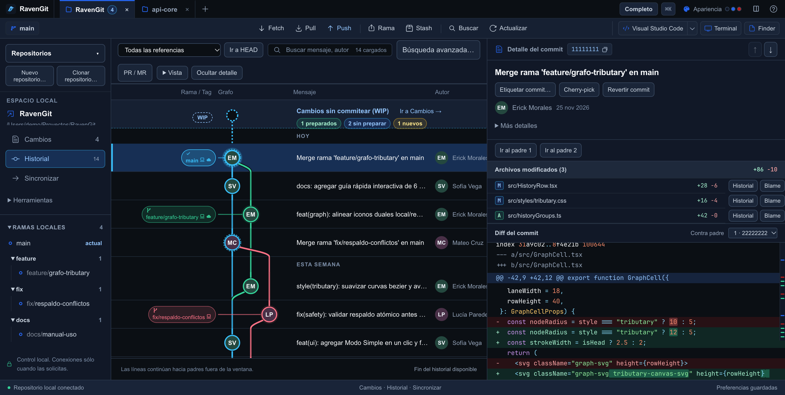
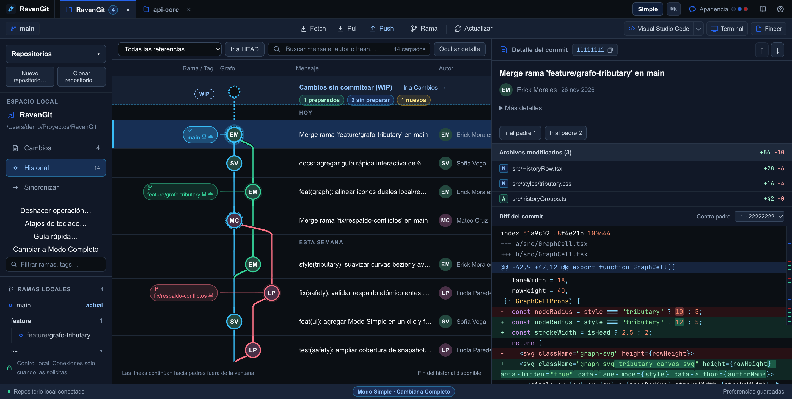
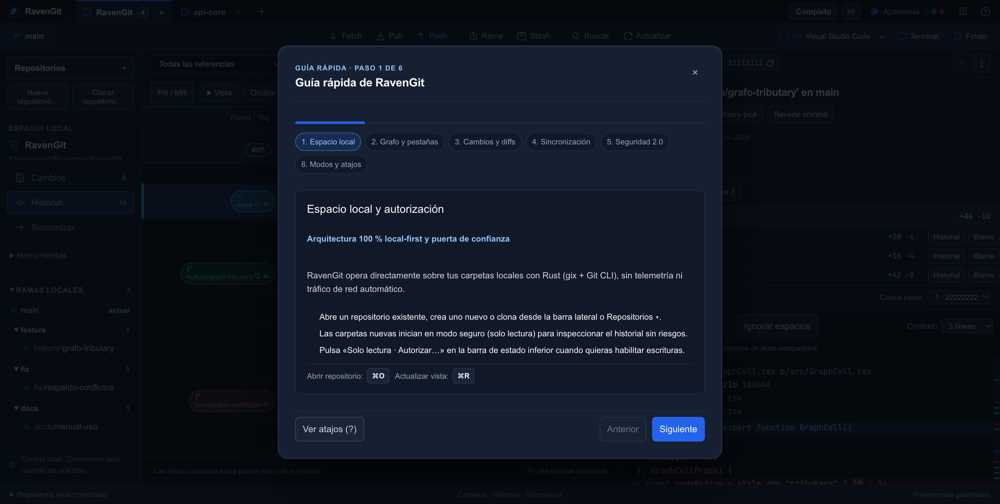

# Manual de uso de RavenGit

Bienvenido al manual oficial de **RavenGit**, un cliente Git de escritorio visual, **local-first** y diseñado para inspeccionar historiales, gestionar ramas y resolver conflictos con rapidez y control total sobre tu equipo.

---

## Arquitectura local-first y garantías

- **100 % Offline-first:** RavenGit no incluye telemetría ni realiza conexiones automáticas en segundo plano. Todas las lecturas locales se ejecutan directamente en tu equipo mediante **Rust + `gix` (*gitoxide*)** y Git CLI nativo para escrituras, hooks y remotos.
- **Conexiones solo bajo solicitud:** operaciones como `Fetch`, `Pull`, `Push`, publicación de etiquetas o consulta de Pull Requests / Merge Requests solo ocurren cuando tú las confirmas explícitamente.
- **Seguridad antes de modificar:** los repositorios recién abiertos inician con puerta de confianza (solo lectura hasta autorizar), y las operaciones críticas generan respaldos locales automáticos.

## Requisitos del sistema

- **Git CLI:** Git **2.38 o superior** accesible en la variable `PATH`.
- **Windows:** Windows 10 u 11 (x64) con Microsoft Edge WebView2 (incluido por defecto).
- **macOS:** macOS 12 (Monterey) o superior en Apple Silicon (`arm64`) o Intel (`x86_64`).
- **Linux:** distribuciones x64 modernas (paquetes `.deb` y `.AppImage`) con `libwebkit2gtk-4.1` (y `libfuse2` para AppImage).

> **Consejo:** abre **Herramientas → Entorno y motor Git…** en cualquier momento para comprobar la versión detectada de Git CLI, `gix` y Git LFS.

---

## Primeros pasos en 5 minutos

1. **Abre, crea o clona un repositorio**
   - Pulsa **Abrir repositorio local** (o `⌘O` / `Ctrl+O`) para seleccionar una carpeta con repositorio Git.
   - También puedes usar **Nuevo repositorio…** o **Clonar repositorio…** en la parte superior de la barra lateral, o abrir tu **Biblioteca** desde el botón **Repositorios ▾**.
2. **Autoriza escrituras locales cuando lo necesites**
   - Si abres una ruta nueva en modo seguro, la barra de estado inferior mostrará **Solo lectura · Autorizar…**. En ese estado puedes explorar el grafo, diffs y archivos sin riesgo; cuando quieras hacer commits, crear ramas o sincronizar, pulsa **Autorizar…**.
3. **Recorre tus tres vistas principales**
   - **Cambios (`⌘1` / `Ctrl+1`):** prepara archivos, bloques (*hunks*) o líneas y crea commits.
   - **Historial (`⌘2` / `Ctrl+2`):** explora el grafo de commits, compara rangos y revisa detalles.
   - **Sincronizar (`⌘3` / `Ctrl+3`):** gestiona remotos, `Fetch`, `Pull` y `Push` con vista previa.
4. **Elige entre Modo Simple y Modo Completo**
   - En la barra superior derecha puedes alternar con un clic entre **Completo** y **Simple** (también desde la barra lateral, la barra de estado o la Paleta de comandos `⌘K` / `Ctrl+K`).
   - **Modo Simple** oculta herramientas avanzadas (como rebase interactivo, worktrees, LFS, submódulos, snapshots avanzados o hashes en el grafo) para centrarse en editar, commitear, cambiar de rama y sincronizar.
   - **Modo Completo** expone el conjunto íntegro de herramientas profesionales de RavenGit.

   

5. **Consulta ayuda rápida dentro de la app**
   - Pulsa el botón **Guía rápida** (en la pantalla de bienvenida, la barra superior o la barra lateral) para ver el recorrido interactivo de 6 pasos, o presiona **`?`** fuera de campos de texto para abrir la guía de **Atajos de teclado**.

   

---

## Índice de guías

| Guía | Contenido principal |
| :--- | :--- |
| 1. [Interfaz, grafo Tributary y navegación](interfaz-y-grafo.md) | Pestañas multi-repo, barra lateral, estilos *Tributary* vs. *Compacto*, columna `Rama / Tag`, filtros, los 7 temas, las 5 paletas y Paleta de comandos (`⌘K`). |
| 2. [Cambios locales, diffs y commits](cambios-y-commits.md) | Vista `Cambios`, staging/descarte granular por archivo/hunk/línea, diff dividido, diff visual de imágenes, commits, `amend`, `index.lock` y `Stash`. |
| 3. [Ramas, rebase interactivo, conflictos y etiquetas](ramas-y-conflictos.md) | Gestión y agrupación de ramas, `Merge`, `Cherry-pick`, `Revert`, rebase interactivo visual, editor de conflictos a 3 vías y etiquetas. |
| 4. [Sincronización, remotos y PRs / MRs opt-in](sincronizacion-y-forjas.md) | Flujo de `Fetch`, `Pull` y `Push`, remotos SSH/HTTPS, y consulta opt-in de Pull Requests / Merge Requests con `gh` y `glab`. |
| 5. [Seguridad 2.0 y herramientas avanzadas](herramientas-y-seguridad.md) | Snapshots locales, `Undo / Redo` con vista previa, `.git/ravengit-restore/`, búsqueda profunda (`-S`/`-G`), `--follow`, Blame, comparación de rango, worktrees y Git LFS / Submódulos. |
| 6. [Atajos de teclado, entorno y soporte](atajos-y-soporte.md) | Referencia completa de los 18 atajos de teclado, verificador de entorno y solución de problemas habituales. |

---

**Siguiente:** [Interfaz, grafo Tributary y navegación →](interfaz-y-grafo.md)
