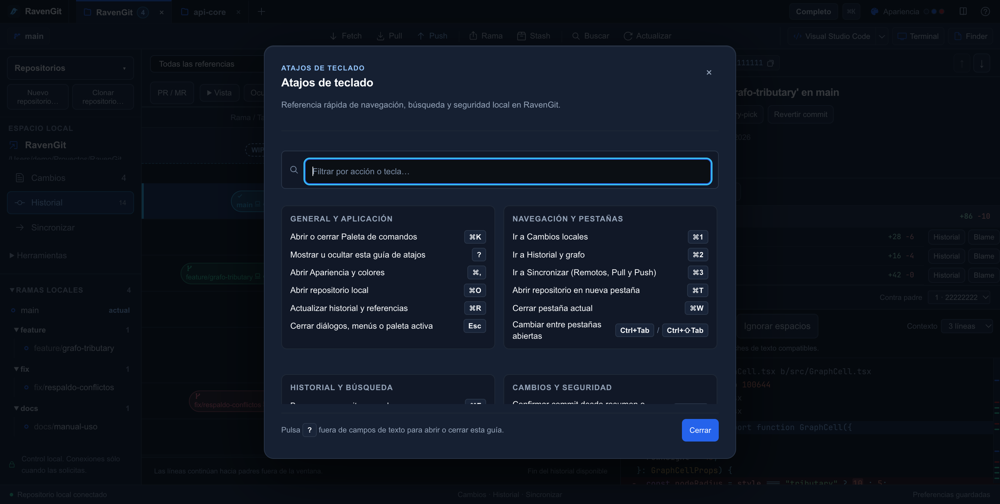

# Atajos de teclado, entorno y soporte

[← Seguridad 2.0 y herramientas avanzadas](herramientas-y-seguridad.md) · [Índice](README.md)

---

## Referencia de atajos de teclado (`?`)

Presiona **`?`** fuera de cualquier campo de texto para abrir la guía interactiva filtrable dentro de RavenGit. Estos son los 18 atajos disponibles:

### General y aplicación
| Acción | macOS | Windows / Linux |
| :--- | :--- | :--- |
| Abrir o cerrar Paleta de comandos | `⌘K` | `Ctrl+K` |
| Mostrar u ocultar guía de atajos | `?` | `?` |
| Abrir Apariencia y colores | `⌘,` | `Ctrl+,` |
| Abrir repositorio local | `⌘O` | `Ctrl+O` |
| Actualizar historial y referencias | `⌘R` | `Ctrl+R` |
| Cerrar diálogos, menús o paleta activa | `Esc` | `Esc` |

### Navegación y pestañas
| Acción | macOS | Windows / Linux |
| :--- | :--- | :--- |
| Ir a Cambios locales | `⌘1` | `Ctrl+1` |
| Ir a Historial y grafo | `⌘2` | `Ctrl+2` |
| Ir a Sincronizar (Remotos, Pull y Push) | `⌘3` | `Ctrl+3` |
| Abrir repositorio en nueva pestaña | `⌘T` | `Ctrl+T` |
| Cerrar pestaña actual | `⌘W` | `Ctrl+W` |
| Cambiar entre pestañas abiertas | `Ctrl+Tab` / `Ctrl+⇧Tab` | `Ctrl+Tab` / `Ctrl+⇧Tab` |

### Historial y búsqueda
| Acción | macOS | Windows / Linux |
| :--- | :--- | :--- |
| Buscar en commits cargados | `⌘F` | `Ctrl+F` |
| Búsqueda profunda en historial y código | `⇧⌘F` | `Ctrl+⇧F` |
| Navegar commits en resultados | `↑` / `↓` | `↑` / `↓` |
| Comparar rango entre dos commits | `Shift+Clic` | `Shift+Clic` |

### Cambios y seguridad
| Acción | macOS | Windows / Linux |
| :--- | :--- | :--- |
| Confirmar commit (desde resumen o descripción) | `⌘Enter` | `Ctrl+Enter` |
| Deshacer última operación local (vista previa) | `⌘Z` | `Ctrl+Z` |
| Rehacer operación local (vista previa) | `⇧⌘Z` / `⌘Y` | `Ctrl+⇧Z` / `Ctrl+Y` |

---

## Verificador de entorno (`Herramientas → Entorno y motor Git…`)

Si sospechas de algún problema con tu instalación local de Git o quieres validar qué herramientas detecta RavenGit, abre **Entorno y motor Git…** para comprobar:

- **Motor integrado `gix` (*gitoxide*):** siempre embebido para lecturas rápidas del grafo y referencias.
- **Git CLI en `PATH`:** muestra la ruta detectada y confirma si cumple con la versión recomendada (**2.38+**). Si falta, el diálogo ofrece comandos listos para copiar (`winget`, `xcode-select --install`, `brew` o gestor de paquetes) y un botón **Volver a comprobar**.
- **Git LFS:** informa si la extensión `git-lfs` está disponible en el equipo.

---

## Solución de problemas frecuentes

### 1. «Git CLI no detectado en el equipo»
- Instala Git 2.38 o superior y asegúrate de que `git` esté disponible en `PATH`.
- En Windows puedes instalarlo con `winget install --id Git.Git -e --source winget`; en macOS, con `xcode-select --install` o `brew install git`.
- Pulsa **Volver a comprobar** en **Entorno y motor Git…** o reinicia RavenGit.

### 2. El repositorio abre en «Solo lectura · Autorizar…» y no deja hacer commits
- Es la puerta de confianza local-first de RavenGit para proteger carpetas nuevas contra escrituras o ejecuciones no deseadas.
- Haz clic en **Solo lectura · Autorizar…** en la barra de estado inferior (o en el aviso correspondiente dentro de Cambios / PRs) y confirma la autorización para esa ruta.

### 3. Error o aviso de `.git/index.lock` al preparar cambios o hacer commit
- Significa que otro proceso (otra terminal, IDE o una ejecución interrumpida de Git) dejó un archivo de bloqueo activo en `.git/index.lock`.
- Verifica que no haya otro comando `git` ejecutándose sobre el mismo repositorio antes de retirar el bloqueo manualmente en el explorador o terminal si quedó huérfano.

### 4. «Pull Requests / MRs…» muestra que falta autenticación o no lista resultados
- Comprueba en tu terminal que el CLI oficial esté instalado y autenticado para el host del remoto:
  - GitHub: `gh auth status` (inicia sesión con `gh auth login`).
  - GitLab: `glab auth status` (inicia sesión con `glab auth login`).
- Recuerda autorizar el repositorio si sigue en modo solo lectura y pulsar explícitamente el botón de consulta dentro del diálogo.

### 5. «Este commit está fuera de la ventana cargada» al saltar a una rama o etiqueta
- Por rendimiento, RavenGit carga el historial de manera progresiva.
- Desplázate al final de la lista para cargar más commits, selecciona la rama directamente en el selector de alcance del historial, o utiliza **Búsqueda profunda** (`⇧⌘F` / `Ctrl+⇧F`).

### 6. Fallo de autenticación en `Fetch`, `Pull` o `Push`
- Verifica en terminal si tu llave SSH está cargada (`ssh -T git@github.com` o equivalente) o si tu *credential helper* HTTPS tiene acceso al remoto configurado.
- En **Sincronizar → Remotos y Fetch**, revisa que la URL del remoto (`SSH` vs. `HTTPS`) coincida con el método de credenciales que tienes configurado en tu equipo.

---

[← Seguridad 2.0 y herramientas avanzadas](herramientas-y-seguridad.md) · [Índice](README.md)
