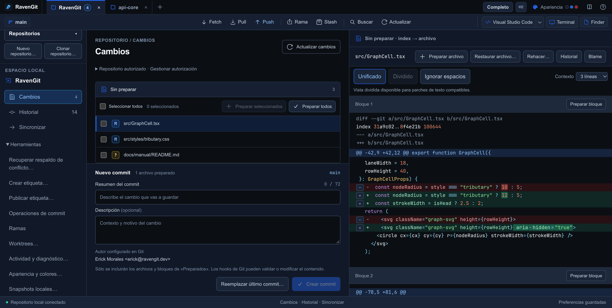

# Cambios locales, diffs y commits

[← Interfaz, grafo Tributary y navegación](interfaz-y-grafo.md) · [Índice](README.md) · [Siguiente: Ramas, rebase interactivo, conflictos y etiquetas →](ramas-y-conflictos.md)

---

## Panel de Cambios

Accede pulsando **Cambios** en la barra lateral, con el atajo **`⌘1` / `Ctrl+1`**, o haciendo clic en la fila **Cambios sin commitear (WIP)** del grafo.

El área de trabajo separa claramente los archivos en dos listas:

- **Cambios en el árbol de trabajo (*Unstaged*):** archivos modificados o sin seguimiento (*untracked*) aún no incluidos en el próximo commit.
- **Preparados (*Staged*):** cambios listos en el índice de Git que formarán parte del próximo commit.

> Para preparar, descartar o crear commits el repositorio debe estar autorizado (no en modo solo lectura).

---

## Staging y descarte granular

RavenGit ejecuta modificaciones de índice en transacciones atómicas para evitar estados corruptos:

- **Por archivo:** prepara o retira de preparación archivos completos con un clic o por selección múltiple.
- **Por bloque (*hunk*):** desde el visor de diff de un archivo, prepara o revierte únicamente el bloque de líneas que te interesa incluir en este commit.
- **Por línea individual:** selecciona líneas específicas dentro de un bloque para hacer *stage* parcial o descartar exactamente esos cambios.
- **Respaldo al descartar:** al descartar cambios en archivos modificados, RavenGit guarda una copia de seguridad automática en `.git/ravengit-restore/` para que puedas recuperarla si cambiaste de opinión.

---

## Visor de diff de texto

Tanto en **Cambios** como en el **Inspector de commits** y en la **Comparación de rango**, el visor ofrece:

- **Modo Unificado o Dividido (Side-by-side):** alterna entre vista continua y comparación en dos columnas.
- **Diferencias intra-línea:** resalta exactamente los caracteres o tokens modificados dentro de cada línea cambiada.
- **Resaltado de sintaxis:** coloreado léxico adaptado al lenguaje del archivo y al tema activo (oscuro, claro o alto contraste).
- **Líneas de contexto configurables e ignorar espacios en blanco:** ajusta cuántas líneas alrededor de cada cambio deseas ver o filtra cambios meramente de indentación/espacios.
- **Minimapa lateral:** barra de navegación rápida para saltar directamente a los bloques añadidos o eliminados en archivos extensos.

---

## Diff visual de imágenes

Cuando seleccionas un archivo de imagen modificado o inspeccionas un commit que cambia activos gráficos, RavenGit muestra un comparador visual especializado con tres modos:

1. **Lado a lado:** muestra la versión anterior y la nueva una junto a otra.
2. **Cortina deslizable:** superpone ambas imágenes con un divisor interactivo para detectar desplazamientos o variaciones de píxel.
3. **Superposición / Transparencia:** combina ambas capas para resaltar diferencias sutiles.

Si necesitas inspeccionar el puntero o contenido textual (por ejemplo en SVG o punteros LFS), puedes alternar a la vista de texto cuando esté disponible.

---

## Crear commits, Amend e `index.lock`

En la zona de commit del panel **Cambios**:

1. Escribe un **resumen** claro (y opcionalmente una **descripción** extendida).
2. RavenGit muestra el autor configurado en Git antes de confirmar.
3. Pulsa **Confirmar commit** o usa el atajo **`⌘Enter` / `Ctrl+Enter`** directamente desde el resumen o la descripción.

### Amend (corregir el último commit)
- Activa la opción **Amend** (disponible en Modo Completo o flujo de corrección) para incorporar los cambios preparados al último commit o actualizar su mensaje.
- Antes de ejecutar `amend`, RavenGit crea un respaldo local automático para poder revertirlo mediante **Undo**.

### Protección ante `index.lock`
- Si otro proceso de Git o herramienta externa dejó un archivo `.git/index.lock` bloqueando el repositorio, RavenGit lo detecta y te informa con claridad en lugar de fallar con errores crípticos, evitando sobrescribir operaciones concurrentes.

---

## Stash (guardado temporal)

Abre **Stash** desde la barra superior para apartar cambios sin commitear cuando necesites cambiar de rama o probar algo limpio:

- **Guardar Stash:** permite incluir archivos preparados y archivos sin seguimiento (*untracked*) con un mensaje descriptivo.
- **Aplicar o restaurar:** inspecciona las entradas guardadas y aplícalas preservando la entrada en tu lista si deseas conservar el respaldo temporal.

---

[← Interfaz, grafo Tributary y navegación](interfaz-y-grafo.md) · [Índice](README.md) · [Siguiente: Ramas, rebase interactivo, conflictos y etiquetas →](ramas-y-conflictos.md)
