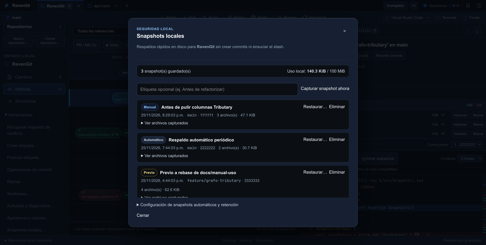

# Seguridad 2.0 y herramientas avanzadas

[← Sincronización, remotos y PRs / MRs opt-in](sincronizacion-y-forjas.md) · [Índice](README.md) · [Siguiente: Atajos de teclado, entorno y soporte →](atajos-y-soporte.md)

---

## Seguridad 2.0: Snapshots, Undo / Redo y Restauración

RavenGit incorpora varias capas de protección local para evitar pérdidas de trabajo incluso en operaciones avanzadas:

### Snapshots locales (`Herramientas → Snapshots locales…`)
- **Capturas manuales y automáticas:** puedes tomar un snapshot en cualquier momento o dejar que RavenGit cree respaldos automáticos antes de operaciones críticas y de forma periódica cuando hay trabajo en curso.
- **Límites configurables:** ajusta desde el diálogo si los snapshots automáticos están activos, su intervalo (**1–120 minutos**, por defecto **10**), el máximo de snapshots retenidos (**5–200**, por defecto **30**) y el límite de espacio en disco (**10–2048 MB**, por defecto **100 MB**).
- **Restauración selectiva:** inspecciona cuándo se creó cada snapshot y restáuralo si necesitas recuperar un estado anterior.

### Undo / Redo con vista previa (`⌘Z` / `Ctrl+Z` y `⇧⌘Z` / `Ctrl+⇧Z`)
- Si cometes un error al crear un commit, hacer `amend`, cambiar o mover una referencia local, pulsa **`⌘Z` / `Ctrl+Z`** (o **Deshacer operación…** en la barra lateral).
- Antes de tocar el repositorio, RavenGit muestra una **vista previa exacta del plan** de deshacer o rehacer (`⇧⌘Z` / `Ctrl+⇧Z` / `Ctrl+Y`) y valida que el estado actual no haya quedado obsoleto.

### Respaldos automáticos al descartar y conflictos
- Los descartes de cambios locales crean respaldos atómicos en **`.git/ravengit-restore/`** con verificación anti-obsolescencia (`STALE_RESTORE`), para evitar sobrescribir accidentalmente archivos que cambiaron después del respaldo.
- Para conflictos interrumpidos, **Herramientas → Recuperar respaldo de conflicto…** restaura la instantánea previa al inicio del merge o rebase.

---

## Búsqueda profunda en historial y código

Cuando necesitas ir más allá de los commits ya paginados en pantalla, abre la **Búsqueda profunda** con **`⇧⌘F` / `Ctrl+⇧F`** (o desde el panel de búsqueda / Paleta de comandos):

- Busca en **todo el historial del repositorio** sin limitarte a la ventana cargada.
- Filtra por texto en el mensaje, **autor**, rango de **fechas**, **ruta** de archivo y **expresiones regulares**.
- Activa la búsqueda en código fuente (**`-S`** para cambios en ocurrencias de una cadena / **`-G`** para coincidencias regex dentro de diffs) para encontrar en qué commit se añadió o eliminó una función o símbolo concreto.

---

## Historial de archivo (`--follow`), Git Blame y Comparación de rango

- **Historial de un archivo (`--follow`):** desde el menú contextual de cualquier archivo en el Inspector o en Cambios, abre la evolución completa de ese archivo siguiendo incluso sus renombrados.
- **Git Blame interactivo:** inspecciona línea por línea qué commit y qué autor modificaron por última vez un archivo, y salta directamente al commit correspondiente.
- **Comparación de rango (`Shift+Clic`):** selecciona un commit en el grafo y haz **`Shift+Clic`** sobre otro commit (o usa la opción del menú contextual) para abrir el diff combinado entre ambos puntos, con botón para invertir el sentido de la comparación (`A..B` ↔ `B..A`).

---

## Git Worktrees (`Herramientas → Worktrees…`)

Si trabajas en dos ramas a la vez sin querer hacer `stash` ni duplicar todo el repositorio:

- **Crear worktree:** asigna una carpeta externa y una rama nueva o existente.
- **Abrir en pestaña:** cualquier worktree listado en la sección **WORKTREES** de la barra lateral se abre en su propia pestaña de RavenGit con un clic.
- **Bloquear / Desbloquear y limpiar:** protege worktrees en discos extraíbles y limpia entradas obsoletas (*prune*) desde el diálogo o menú contextual.

---

## Git LFS y Submódulos (`Herramientas → Git LFS y Submódulos…`)

Panel unificado para proyectos con binarios pesados o repositorios anidados:

- **Git LFS:** consulta el estado de Git LFS, inspecciona archivos rastreados/punteros, descarga objetos bajo demanda y gestiona bloqueos LFS.
- **Submódulos Git:** revisa el estado de cada submódulo configurado e inicialízalos o actualízalos explícitamente cuando el repositorio esté autorizado.

---

## Actividad y diagnóstico (`Herramientas → Actividad y diagnóstico…`)

Consulta el historial local de operaciones ejecutadas por RavenGit en la sesión y diagnósticos detallados cuando necesites revisar qué comando Git o lectura interna ocurrió y su resultado.

---

[← Sincronización, remotos y PRs / MRs opt-in](sincronizacion-y-forjas.md) · [Índice](README.md) · [Siguiente: Atajos de teclado, entorno y soporte →](atajos-y-soporte.md)
