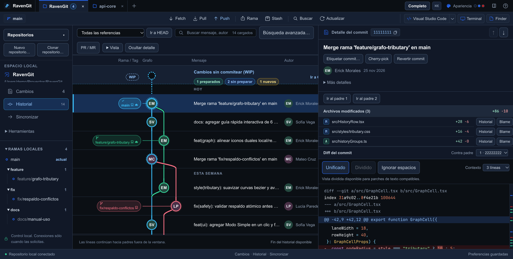
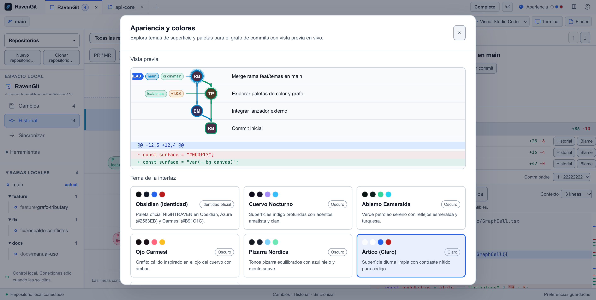

# Interfaz, grafo Tributary y navegación

[← Índice del manual](README.md) · [Siguiente: Cambios locales, diffs y commits →](cambios-y-commits.md)

---

## Pestañas multi-repositorio

RavenGit permite trabajar con varios repositorios abiertos de forma simultánea (hasta 12 pestañas guardadas en tu sesión local), manteniendo vistas y bloqueos de escritura aislados por repositorio:

- **Abrir en nueva pestaña:** botón **`+`** junto a las pestañas, atajo **`⌘T` / `Ctrl+T`** o clic sobre un worktree secundario.
- **Cambiar de pestaña:** **`Ctrl+Tab`** / **`Ctrl+⇧Tab`**, o clic directo en la barra superior.
- **Reordenar pestañas:** arrastra y suelta cualquier pestaña en la barra superior.
- **Cerrar pestaña:** botón `×`, clic central del ratón o **`⌘W` / `Ctrl+W`**.
- **Indicador de actividad:** las pestañas muestran un contador numérico cuando existen cambios locales sin commitear (cuando el repositorio está autorizado).

---

## Barra lateral izquierda

La barra lateral organiza el contexto del repositorio activo:

- **Control de biblioteca y creación:** botón **Repositorios ▾** (abre tu biblioteca local y colecciones), **Nuevo repositorio…** y **Clonar repositorio…**.
- **Vistas principales:** **Cambios**, **Historial** y **Sincronizar**.
- **Cajón de Herramientas** (en Modo Completo): acceso directo a recuperación de conflictos, creación/publicación de etiquetas, operaciones de commit, ramas, worktrees, actividad y diagnóstico, apariencia, snapshots locales, Git LFS y Submódulos, Pull Requests / MRs, Undo/Redo, entorno Git, guía rápida y atajos de teclado.
- **Secciones de referencias:**
  - **RAMAS LOCALES:** agrupadas automáticamente por prefijo (por ejemplo `feature/`, `fix/`), con indicador `actual` sobre tu rama activa.
  - **REFERENCIAS REMOTAS** y **ETIQUETAS** (visibles en Modo Completo).
  - **WORKTREES** (visibles en Modo Completo): muestra worktrees asociados y permite abrirlos en pestaña con un clic o gestionarlos desde su menú contextual.
- **Clic vs. clic derecho en referencias:** hacer clic sobre una rama o etiqueta **localiza el commit en el historial sin cambiar tu rama activa**; para cambiar de rama, fusionar o renombrar, usa el menú contextual (clic derecho).

---

## Estilos de grafo: Tributary y Compacto

Desde **Apariencia y colores…** (`⌘,` / `Ctrl+,`) puedes elegir cómo se dibuja el historial:

### 1. Tributary (Avatares) — predeterminado
- **Columna `Rama / Tag` a la izquierda:** muestra las referencias alineadas en su propia columna dedicada. Puedes ajustar su ancho entre **`120` y `280 px`** arrastrando su separador, usando las flechas de teclado sobre el divisor o desde el control de opciones de vista.
- **Iconos duales de sincronización local/remoto:** cuando una rama local y su equivalente remota apuntan al mismo commit, RavenGit colapsa el pill remoto redundante y muestra ambos indicadores junto a la rama local para mantener el grafo limpio.
- **Avatares circulares y curvas amplias:** los nodos muestran iniciales/avatar del autor y las ramificaciones usan curvas suaves estilo metro.
- **Separadores temporales:** divide automáticamente la línea temporal en grupos **`Hoy`**, **`Esta semana`** y **`Anterior`** manteniendo continuos los carriles SVG del grafo.

### 2. Compacto (Puntos)
- Grafo denso clásico con nodos circulares pequeños y etiquetas de rama/tag en línea junto al mensaje del commit, ideal si prefieres ver más filas simultáneas.

---

## Fila WIP, filtros, alcance e inspector

- **Cambios sin commitear (WIP):** cuando hay modificaciones pendientes en un repositorio autorizado, aparece una fila especial conectada directamente a `HEAD` gracias al observador local en tiempo real. Al pulsarla pasas a la vista **Cambios**.
- **Carga progresiva:** el historial se pagina con scroll infinito para mantener fluidez incluso en repositorios grandes.
- **Selector de alcance:** filtra el árbol por **Todas las referencias**, **Rama actual / HEAD** o una rama local/remota específica, además del botón **Ir a HEAD**.
- **Búsqueda en commits cargados (`⌘F` / `Ctrl+F`):** filtra por mensaje, autor o hash en la ventana cargada y permite navegar con `↑`, `↓`, `Inicio` y `Fin`. *(Para buscar en todo el repositorio o dentro del código, usa la [búsqueda profunda](herramientas-y-seguridad.md#búsqueda-profunda-en-historial-y-código).)*
- **Personalización de columnas e inspector:** en Modo Completo, el botón de opciones de vista de la tabla permite mostrar u ocultar **Autor** y **Hash**, ajustar sus anchos y regular el ancho del panel **Inspector** derecho (**`30–60 %`**). Estas preferencias se recuerdan por repositorio.

---

## Apariencia: 7 temas y 5 paletas de grafo

Abre **Apariencia y colores…** desde la barra superior o con **`⌘,` / `Ctrl+,`**:

### Temas disponibles (7)
1. **Obsidian (Identidad):** tema oscuro oficial de RavenGit con Obsidian, Azure y Carmesí.
2. **Cuervo Nocturno:** tonos índigo con acentos amatista y cian.
3. **Abismo Esmeralda:** verde petróleo con reflejos esmeralda y turquesa.
4. **Ojo Carmesí:** grafito cálido con acentos carmesí y ámbar.
5. **Pizarra Nórdica:** azul pizarra equilibrado con acentos hielo y menta.
6. **Ártico (Claro):** interfaz diurna luminosa de alto contraste para código.
7. **Alto Contraste:** negro puro, bordes definidos y foco amarillo de alta accesibilidad.

### Paletas de carriles del grafo (5)
- **Vibrante (GitKraken)**, **Identidad Extendida**, **Neón Eléctrico**, **Tributary Suave** y **Alta Distinción** (basada en Okabe-Ito para daltonismo). Cada paleta adapta automáticamente sus tonos según si el tema elegido es oscuro o claro.

---

## Paleta de comandos y aplicaciones externas

- **Paleta de comandos (`⌘K` / `Ctrl+K`):** ejecuta vistas, diálogos, búsqueda profunda, cambio entre Modo Simple/Completo o cambio de apariencia escribiendo cualquier parte del nombre de la acción.
- **Abrir en herramienta externa:** desde la esquina derecha de la barra de herramientas puedes abrir el repositorio directamente en tu **editor**, **terminal** o **explorador de archivos** configurado localmente.

---

[← Índice del manual](README.md) · [Siguiente: Cambios locales, diffs y commits →](cambios-y-commits.md)
