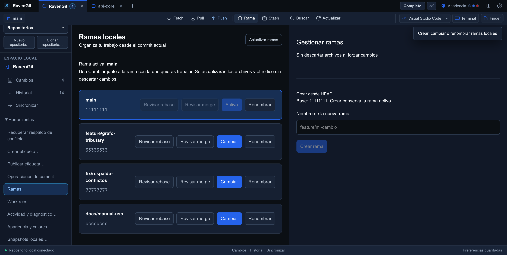

# Ramas, rebase interactivo, conflictos y etiquetas

[← Cambios locales, diffs y commits](cambios-y-commits.md) · [Índice](README.md) · [Siguiente: Sincronización, remotos y PRs / MRs opt-in →](sincronizacion-y-forjas.md)

---

## Gestión de ramas

Puedes trabajar con ramas desde tres lugares según te resulte más cómodo:

- **Barra superior (`Rama`)** o **Herramientas → Ramas**: abre la vista completa de gestión de ramas.
- **Barra lateral (`RAMAS LOCALES`)**: muestra tus ramas agrupadas por prefijo (`feature/`, `fix/`, etc.). Un clic centra el historial en esa rama sin cambiar `HEAD`; **clic derecho** abre el menú de acciones.
- **Menú contextual en el grafo:** haz clic derecho sobre cualquier commit para crear una rama desde ese punto o realizar operaciones sobre ella.

Acciones disponibles:
- **Crear rama:** desde `HEAD` o desde un commit concreto, validando nombres y colisiones antes de escribir.
- **Cambiar de rama (*Checkout*):** cambia la rama activa de forma segura verificando conflictos con cambios locales.
- **Renombrar y eliminar ramas:** con confirmación clara cuando una rama tiene commits no fusionados.

---

## Merge, Cherry-pick, Revert y Operaciones de commit

Desde el menú contextual de commits/ramas y **Herramientas → Operaciones de commit**:

- **Merge:** fusiona otra rama local o remota en tu rama actual.
- **Cherry-pick:** copia un commit específico hacia tu rama actual sin traer toda la rama de origen.
- **Revert:** crea un nuevo commit que deshace de forma segura los cambios introducidos por un commit pasado (ideal en ramas compartidas).

---

## Rebase interactivo visual

En Modo Completo puedes reorganizar secuencias lineales recientes (**de 1 a 50 commits**) mediante el asistente visual de rebase interactivo:

1. Abre el rebase interactivo desde **Operaciones de commit** o el menú contextual del rango.
2. Reordena los commits en la lista y elige la acción para cada uno:
   - **`pick`:** mantener el commit tal cual.
   - **`reword`:** conservar los cambios y editar el mensaje.
   - **`squash`:** fusionar el commit con el anterior combinando sus mensajes.
   - **`fixup`:** fusionar cambios con el commit anterior descartando el mensaje de este commit.
   - **`drop`:** eliminar el commit de la secuencia.
3. Antes de iniciar el rebase, RavenGit crea un **respaldo local automático** que te permite volver atrás si el resultado no es el esperado.

---

## Editor visual de conflictos a 3 vías

Si una operación (`merge`, `rebase`, `cherry-pick` o `revert`) produce conflictos:

- RavenGit detecta el estado en curso y te ofrece abrir el **Editor de conflictos** en tres columnas/paneles:
  - **Base:** ancestro común antes de que las ramas divergieran.
  - **Local (Nuestro):** estado de tu rama actual.
  - **Entrante (Suyo):** cambios que estás integrando.
- Para cada bloque en conflicto puedes elegir **Aceptar Local**, **Aceptar Entrante**, **Aceptar ambos** o editar manualmente el resultado antes de marcar el archivo como resuelto.
- Si algo sale mal durante una resolución compleja, **Herramientas → Recuperar respaldo de conflicto…** te permite volver al respaldo previo tomado automáticamente al iniciar la operación.

---

## Etiquetas (Tags)

- **Crear etiqueta (`Herramientas → Crear etiqueta…` o menú contextual en commit):** crea etiquetas ligeras o anotadas sobre `HEAD` o cualquier commit del historial.
- **Publicar etiqueta (`Herramientas → Publicar etiqueta…`):** selecciona explícitamente qué etiqueta local enviar y hacia qué remoto autorizado publicarla, sin envíos masivos accidentales (`--tags` automático).

---

[← Cambios locales, diffs y commits](cambios-y-commits.md) · [Índice](README.md) · [Siguiente: Sincronización, remotos y PRs / MRs opt-in →](sincronizacion-y-forjas.md)
