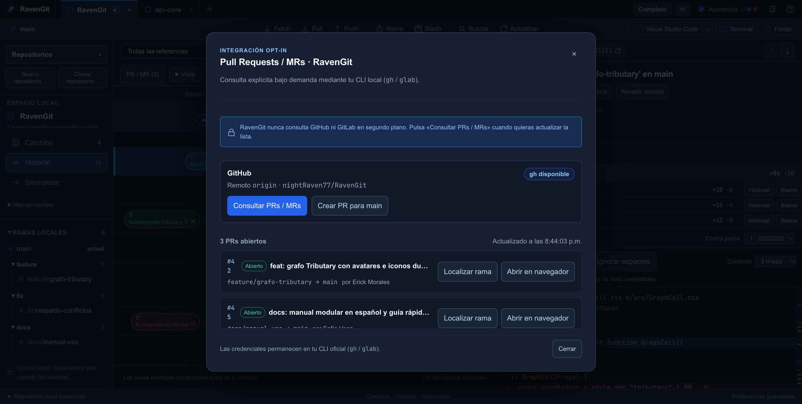

# Sincronización, remotos y Pull Requests / Merge Requests opt-in

[← Ramas, rebase interactivo, conflictos y etiquetas](ramas-y-conflictos.md) · [Índice](README.md) · [Siguiente: Seguridad 2.0 y herramientas avanzadas →](herramientas-y-seguridad.md)

---

## Principio de cero tráfico automático

RavenGit **nunca** ejecuta `fetch`, `pull`, `push` ni consultas a APIs de forjas en segundo plano. La barra de estado te recuerda en todo momento `Git local · Sin publicación automática`. Toda conexión de red pasa por la vista **Sincronizar** (`⌘3` / `Ctrl+3`) o por diálogos explícitos donde revisas el destino antes de confirmar.

---

## Vista Sincronizar: Remotos, Pull y Push

### 1. Remotos y Fetch
- Lista los remotos configurados en el repositorio (por ejemplo `origin`, `upstream`) con sus URLs SSH o HTTPS.
- Elige el remoto deseado y confirma **Fetch** para descargar referencias y commits nuevos sin modificar tu árbol de trabajo ni tus ramas locales.

### 2. Pull guiado
- Muestra el *upstream* configurado para la rama activa (o te permite revisarlo antes de continuar).
- Descarga los cambios remotos e integra mediante `merge`, alertando si existen cambios locales incompatibles o conflictos por resolver.

### 3. Publicar (Push)
- Antes de enviar nada al servidor, **Publicar** muestra:
  - El remoto de destino.
  - La rama local y la rama remota asociada (configurando *upstream* si es la primera publicación).
  - La vista previa de los commits salientes que se enviarán.

### Autenticación SSH y HTTPS
RavenGit utiliza el Git CLI y la configuración estándar de tu sistema (llaves SSH en `~/.ssh/`, agente SSH, o *credential helper* de Git en HTTPS como macOS Keychain / Git Credential Manager en Windows). Incluye además soporte de gestión local de cuentas SSH en el flujo de sincronización cuando configuras múltiples identidades en el mismo equipo.

---

## Integración opt-in de Pull Requests / Merge Requests (GitHub y GitLab)

En Modo Completo puedes activar bajo demanda el panel **Herramientas → Pull Requests / MRs…** (también accesible desde la Paleta de comandos `⌘K`):

### Cómo funciona con privacidad estricta
1. **Detección 100 % offline:** al abrir el diálogo, RavenGit inspecciona localmente el remoto del repositorio (`read_forge_info`) para identificar si apunta a **GitHub** (`github.com` o instancia compatible) o **GitLab** (`gitlab.com` o instancia compatible), sin abrir ninguna conexión de red.
2. **Consulta explícita bajo demanda:** la red solo se contacta cuando pulsas **Consultar PRs / MRs**.
3. **Requisitos:**
   - El repositorio debe estar **autorizado** (si está en modo solo lectura, el diálogo te ofrece un botón directo para autorizarlo).
   - Debes tener instalado y autenticado el CLI oficial del proveedor correspondiente:
     - **GitHub:** CLI `gh` autenticado (`gh auth login`).
     - **GitLab:** CLI `glab` autenticado (`glab auth login`).
4. **Uso en la interfaz:**
   - Visualiza la lista de PRs/MRs abiertos o en borrador con su número (`#123`), autor, rama origen y estado.
   - Al consultar, las ramas coincidentes en el historial muestran un badge **`#N`** directamente en el grafo para identificar rápidamente qué rama corresponde a cada PR/MR.
   - Puedes saltar a la rama en el historial o abrir la URL del PR/MR en tu navegador predeterminado (RavenGit valida que el enlace use `https://` y coincida con el host de la forja configurada).

---

[← Ramas, rebase interactivo, conflictos y etiquetas](ramas-y-conflictos.md) · [Índice](README.md) · [Siguiente: Seguridad 2.0 y herramientas avanzadas →](herramientas-y-seguridad.md)
