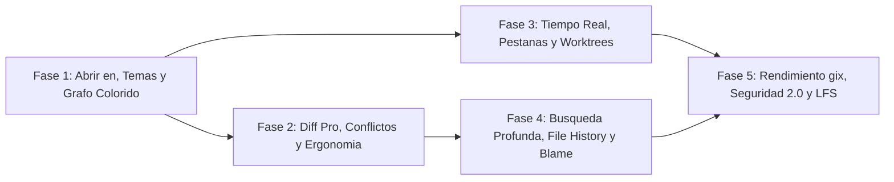

# RavenGit · Plan Maestro de Mejoras

Fecha: 22 de noviembre de 2026.  
Estado: **aprobado** · **Fases 1, 2, 3 y 4 completadas** (Fase 5 pendiente).

Este documento reúne el plan maestro en cinco fases para la evolución de **RavenGit**, integrando ideas de referencia de **GitCraft**, **Tributary** y **GitKraken**, las metas del [Roadmap](../../ROADMAP.md) y los tres cambios prioritarios definidos para el producto (*Abrir en…*, *Grafo colorido* y *Explorador de colores y temas*).

---

## Principios transversales (obligatorios en las 5 fases)

- **Local-first y privacidad estricta:** cero telemetría; ninguna lectura automática dispara tráfico de red ni descargas implícitas.
- **Seguridad en ejecución:** mantener la puerta de confianza ([trust.rs](../../src-tauri/src/trust.rs)), la exclusión mutua de escrituras en [lib.rs](../../src-tauri/src/lib.rs), el flujo *preview → confirmación → ejecución* y llamadas a procesos externos/Git por argumentos separados (nunca por shell interpolado).
- **Accesibilidad y pruebas:** toda nueva vista o diálogo conserva navegación por teclado, roles ARIA, manejo de foco y pruebas automatizadas en **Vitest** + **Rust (`cargo test` y `clippy -D warnings`)**.
- **Versionado limpio:** no alterar versiones de manifiestos hasta el cierre de entrega (`npm run release:check`).

---

## Fase 1 · Base Visual, Identidad Extensible y "Abrir en…"

> **Objetivo:** dar un salto visual y de comodidad inmediata, y dejar listos los cimientos (tokens CSS, `settings-v1.json`, lanzador externo y motor de grafo con color por linaje) para que las fases siguientes los hereden automáticamente. **0 dependencias nuevas.**

### 1.1 Configuración global persistente (`src-tauri/src/settings.rs`)
- Nuevo archivo atómico `settings-v1.json` en `app_config_dir()/workspace/` (mismo patrón seguro que [library.rs](../../src-tauri/src/library.rs), sin romper `repositories-v2.json`).
- Almacena tema activo, paleta del grafo y preferencias de editor/terminal (incluido editor personalizado).

### 1.2 Apartado "Abrir en…" (`src-tauri/src/external.rs` + `src/OpenExternalMenu.tsx`)
- Ubicado en la barra lateral bajo `ESPACIO LOCAL` (debajo de la ruta del repositorio), disponible en todas las vistas cuando hay un repositorio abierto.
- **3 opciones con apertura en 1 clic:**
  1. **Editor (con detector automático + selector `▾`):** detecta en macOS, Windows y Linux **Antigravity IDE**, **VS Code**, VS Code Insiders, Cursor, Windsurf, Zed, VSCodium, Sublime Text, JetBrains (IntelliJ, WebStorm, PyCharm, RustRover, Fleet), Xcode, Nova, Neovide, MacVim y Notepad++; recuerda el editor preferido e incluye **"Elegir otro editor…"** mediante diálogo nativo de archivos.
  2. **Terminal (con detector automático + selector si hay varias):** macOS (Terminal, iTerm2, Warp, Ghostty, WezTerm, kitty, Alacritty, Hyper), Windows (Windows Terminal, PowerShell 7, Windows PowerShell, Git Bash, CMD) y Linux.
  3. **Explorador de archivos:** Finder (macOS), Explorador de archivos (Windows) o gestor nativo (Linux).
- Comandos IPC en [lib.rs](../../src-tauri/src/lib.rs): `read_app_settings`, `save_app_settings`, `read_external_apps`, `open_in_external`.

### 1.3 Mapa / Grafo DAG colorido (`src/graph.ts` + `src/GraphCell.tsx`)
- **Color persistente por linaje:** cada rama mantiene su color a través de su cadena de primer padre aunque cambie de carril; cada rama secundaria de un merge obtiene un color distinto; se mantiene la estabilidad por páginas de 200 commits.
- **Renderizado estilo GitKraken + GitCraft + Tributary:**
  - Carriles Bezier de `2.5px` con sutil halo de separación en los cruces y carriles pasantes vivos.
  - **Nodos diferenciados:** `HEAD` (aura + doble anillo), **Merge** (anillo con núcleo), **Punta de rama / Tag** (nodo con aura suave), **Raíz** (cuadrado redondeado) y **Estándar** (punto sólido con borde del lienzo).
  - **Conector horizontal** del nodo hacia sus pills e indicador lateral de color en la fila seleccionada.
  - **Pills enriquecidos:** ramas locales con el color de su carril + icono de rama, remotos con icono de nube e indicador visual cuando local y remoto coinciden en el mismo commit, etiquetas con icono dorado/ámbar.

### 1.4 Explorador de Colores y Temas (`src/themes.ts` + `src/themes.css` + `src/AppearanceDialog.tsx`)
- **Tokenización completa de CSS:** migración de hexadecimales fijos en `App.css` y `workspace.css` a variables semánticas (`--bg-*`, `--border-*`, `--text-*`, `--accent*`, `--success*`, `--danger*`, `--warning*`, `--hunk-*`), cubriendo paneles, diffs, banners, inputs, scrollbars y diálogos.
- **7 temas de interfaz** (preservando la identidad oficial de [07_Identidad_visual.md](07_Identidad_visual.md) como predeterminada y restaurable en 1 clic):
  - **Obsidian (Identidad)** *(oficial)* · **Cuervo Nocturno** (índigo/amatista) · **Abismo Esmeralda** (petróleo/esmeralda) · **Ojo Carmesí** (grafito cálido/carmesí/ámbar) · **Pizarra Nórdica** (azul-gris equilibrado) · **Ártico (Claro)** *(Roadmap v1.1)* · **Alto Contraste** *(Roadmap v1.1)*.
- **5 paletas independientes para el grafo** (combinables con cualquier tema, con ajuste automático de contraste en modo claro):
  - **Vibrante (GitKraken)** · **Identidad Extendida** · **Neón Eléctrico** · **Tributary Suave** · **Alta Distinción (daltonismo / Okabe-Ito)**.
- **Diálogo "Apariencia y colores"** accesible desde el sidebar con aplicación en vivo sobre toda la app y mini-vista previa integrada (grafo + pills + diff).
- **Ajuste menor:** actualizar el badge de versión `1.0.5` → `1.0.6` en el [README principal](../../README.md).

---

## Fase 2 · Ergonomía Diaria, Diff Pro y Conflictos por Bloque

> **Objetivo:** elevar la inspección de código, la preparación granular y la velocidad operativa al nivel de clientes profesionales.

### 2.1 Inspector de Commit con lista/árbol de archivos (`git.rs` + `App.tsx`)
- Nuevo comando IPC para listar archivos cambiados en un commit con estado (`A/M/D/R`) y conteo de líneas (`+N / -M`) mediante `git diff-tree --numstat`.
- Diff bajo demanda **por archivo individual** al seleccionarlo (resuelve el bloqueo actual del límite de 2 MiB cuando un commit toca muchos archivos).

### 2.2 Visor de Diff de nueva generación (`DiffViewer.tsx` + `ChangesPanel.tsx`)
- **Resaltado de sintaxis (*syntax highlighting*)** adaptado a los tokens de tema (oscuro, claro y alto contraste).
- **Diff intra-línea** (resaltado por palabra/carácter en líneas modificadas — Roadmap v1.1).
- **Controles rápidos de lectura:** botón para ignorar espacios en blanco (`-w`), ajuste de contexto y **barra indicadora/minimapa de cambios** en el scroll.
- **Staging, unstaging y descarte por rango de líneas** (`Shift+Click` sobre líneas dentro de un hunk), reutilizando la aplicación segura por parche en `changes.rs`.

### 2.3 Resolución de conflictos por bloque (`ConflictDialog.tsx`)
- Parser visual de bloques en conflicto (`<<<<<<<` / `=======` / `>>>>>>>`) con botones directos por cada bloque: **Usar local**, **Usar entrante**, **Usar ambos** y edición manual afinada.
- Conserva intactos los respaldos persistentes, la prohibición de guardar marcadores sin resolver y la preparación explícita.

### 2.4 Menús contextuales, Paleta de Comandos y avisos inteligentes
- **Menú contextual (clic derecho)** sobre filas del grafo y referencias del sidebar: *Checkout*, *Crear rama aquí*, *Merge*, *Rebase*, *Cherry-pick*, *Revertir*, *Etiquetar*, *Copiar hash* y *Abrir diff*.
- **Paleta de comandos (`Cmd/Ctrl+K`)** y atajos globales consistentes (`Cmd/Ctrl+F` búsqueda, `Cmd/Ctrl+1/2/3` vistas, `Cmd/Ctrl+R` actualizar, `Cmd/Ctrl+,` apariencia).
- **Advertencia inteligente en `Amend` (`AmendDialog.tsx`):** detectar si `HEAD` ya existe en un tracking remoto y avisar explícitamente antes de reescribir historia publicada.

---

## Fase 3 · Tiempo Real, Multi-Repositorio y Worktrees

> **Objetivo:** eliminar la fricción de trabajar con varios repositorios a la vez y reflejar cambios del editor/terminal automáticamente.

### 3.1 File System Watcher + fila WIP en el grafo
- Observador de archivos en Rust (crate `notify`) con *debounce* (p. ej. 250–400 ms), ignorando ruido interno de `.git/objects` y `.git/ravengit-restore/`, emitiendo eventos Tauri al frontend para refrescar Cambios e Historial automáticamente sin intervención manual.
- **Fila WIP ("Cambios sin commitear")** anclada en la parte superior del grafo cuando el árbol está sucio (con conteo de archivos preparados/sin preparar y clic directo hacia `Cambios`).

### 3.2 Pestañas de repositorios (Tabs)
- Refactorizar `AppState.repository: Option<Repository>` en `lib.rs` hacia un registro de sesiones múltiples (`HashMap<String, RepoSession>`) con bloqueos de escritura por repositorio.
- Barra de pestañas tipo navegador (`Cmd/Ctrl+T`, `Cmd/Ctrl+W`, clic medio para cerrar, reordenables) y persistencia de pestañas abiertas entre reinicios en `settings-v1.json`.

### 3.3 Gestión de Git Worktrees (`src-tauri/src/worktrees.rs`)
- Sección `WORKTREES` en el sidebar para listar worktrees activos, crear nuevos (rama nueva o existente), abrirlos directamente en **nueva pestaña / editor / terminal** (reutilizando `external.rs` de Fase 1), bloquear (`lock`/`unlock`), eliminar con confirmación y ejecutar `prune`.

---

## Fase 4 · Búsqueda Profunda e Inspección Histórica

> **Objetivo:** superar el límite de búsqueda en memoria y dar herramientas completas de arqueología de código.

### 4.1 Búsqueda global en todo el historial
- Búsqueda respaldada por Git en todo el repositorio (no solo los 200 commits cargados), con filtros combinables por **mensaje**, **autor**, **hash**, **rango de fechas**, **ruta de archivo** y **expresión regular**.

### 4.2 Búsqueda en código (`git log -S` / `-G`)
- Modo dedicado para encontrar exactamente en qué commits se agregó o eliminó una cadena o símbolo en el código fuente, mostrando el fragmento coincidente.

### 4.3 File History (`--follow`) y Git Blame
- **Historial por archivo:** consultar todos los commits que tocaron un archivo siguiendo renombres, accesible desde Cambios o desde la lista de archivos de cualquier commit.
- **Git Blame interactivo:** vista línea por línea con autor, fecha, hash y enlace directo para saltar al commit que introdujo esa línea.

### 4.4 Diff de rango de commits
- Seleccionar 2 commits en el grafo (`Shift+Click` o menú contextual *"Comparar con…"*) para inspeccionar el diff acumulado entre ambos puntos.

---

## Fase 5 · Rendimiento a Escala, Seguridad 2.0 y Expansión (v1.1 / v1.2)

> **Objetivo:** máxima velocidad en repositorios grandes, red de seguridad "imposible perder trabajo" y cierre de metas del Roadmap.

### 5.1 Motor híbrido con `gitoxide` (`gix`) + scroll infinito
- Lecturas de grafo, historial y referencias directamente en memoria desde Rust con `gix` (sin spawnear múltiples procesos `git` para lectura), manteniendo Git CLI para escrituras, hooks y credenciales.
- Carga infinita progresiva al desplazarse en el historial (reemplazando el botón manual *"Cargar 200 más"*).

### 5.2 Seguridad 2.0: Snapshots automáticos locales y Undo / Redo
- **Snapshots locales automáticos:** evolución de `worktree_restore.rs` para capturar periódicamente (con retención y límite de disco configurables) el estado del árbol de trabajo sin ensuciar commits ni stashes.
- **Undo / Redo unificado (`Cmd/Ctrl+Z`):** historial de deshacer seguro para operaciones frecuentes (checkout, stash, cherry-pick, rebase, reset, restauración), siempre con confirmación cuando implique mover referencias.

### 5.3 Diff visual de imágenes y assets
- Comparador visual para PNG, JPG, WebP, GIF y SVG con modos **Lado a lado**, **Cortina (*swipe*)**, **Onion-skin** (opacidad) y **Pixel-diff**.

### 5.4 Git LFS, File Locks y Submódulos
- Detección de punteros LFS, estado de descarga/espacio y gestión de bloqueos (`lock` / `unlock`).
- Visualización de estado y actualización controlada de submódulos Git.

### 5.5 Opcionales según audiencia
- **Modo Simple** (inspirado en Tributary): vista simplificada (*Traer últimos → Tus cambios → Enviar*) alternable en 1 clic.
- **Integración opt-in con Forjas (GitHub / GitLab):** detección explícita (nunca automática sin permiso) de PRs/MRs asociados a ramas, visibles como badges en los pills del grafo.

---

## Resumen de dependencias y validación por fase

| Fase | Dependencias nuevas previstas | Verificación obligatoria al cierre |
| --- | --- | --- |
| **Fase 1** | Ninguna (0 crates / 0 paquetes npm) | `npm test`, `npm run build`, `cargo test`, `cargo clippy -D warnings`, `release:check` |
| **Fase 2** | Tokenizador ligero de sintaxis (p. ej. `shiki` / `prism` ligero o motor propio) | Suite completa + pruebas de diff por línea y conflictos por hunk |
| **Fase 3** | `notify` (Rust) para File Watcher | Suite completa + pruebas de concurrencia multi-sesión y worktrees |
| **Fase 4** | Ninguna (comandos Git nativos) | Suite completa + fixtures con renombres (`--follow`), blame y `-S` |
| **Fase 5** | `gix` (Rust, features acotadas) | Benchmarks en repo grande + suite completa + pruebas LFS/imágenes |
