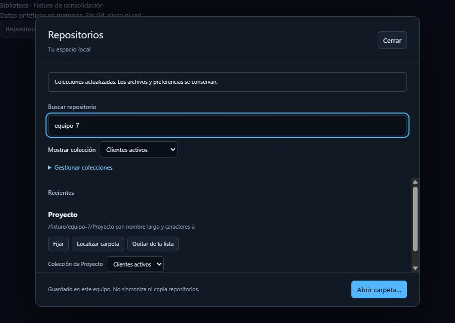

# Colecciones locales

> Actualización macOS del 22/10: Crear/asignar/fijar y conservar pertenencia tras reiniciar comprobados en nativo macOS, con lectura independiente de v2. Migración/relocalización/errores nativos y aceptación completa siguen pendientes. Véanse [evidencia y alcance](MacOS_actual_2026-10-22.md). El registro original de este documento se conserva a continuación.

Fecha: 2026-10-22. Incremento B de RG-07, sobre `6533312` y los cambios locales
de consolidación. Versión de desarrollo 0.4.2, sin declarar publicación ni aceptación
completa del MVP.

## Comportamiento

En Repositorios, Mostrar colección ofrece Todos los repositorios, Sin colección y
las colecciones propias. La búsqueda por nombre/ruta se combina con ese filtro;
Fijados/Recientes y el orden de apertura siguen funcionando dentro de cada vista.

Gestionar colecciones permite crear, renombrar, subir/bajar y quitar con
confirmación. Se admiten hasta 30 colecciones con nombres de 1–80 caracteres,
espacios exteriores normalizados, sin controles ni nombres duplicados al convertir
a minúsculas. Cada colección tiene una identidad estable independiente de nombre
y posición. Subir/Bajar funcionan con botones y teclado, sin arrastre obligatorio.

Cada repositorio puede pertenecer a una colección o a ninguna. Su selector Colección
de… cambia sólo metadatos; puede moverse entre colecciones sin volver a abrir Git.
Las nuevas aperturas se guardan inicialmente sin colección. Todos los repositorios
permite encontrarlos aunque se cambie de grupo. El filtro de colección es de sesión
del diálogo, no una nueva preferencia persistida.

Quitar una colección pasa sus entradas a Sin colección, conservando fijación y
preferencias. No llama a quitar repositorio, no elimina archivos/commits ni modifica
confianza. Quitar de la lista conserva su significado anterior: retira una entrada
y sus preferencias, con confirmación separada. Relocalizar y reabrir conservan la
pertenencia. Cambiar de colección nunca concede autorización en una ruta nueva.

El límite global sigue siendo 100 repositorios. Sólo se expulsa automáticamente la
entrada menos reciente sin fijar y sin colección. Si todas están fijadas o asignadas,
se informa del límite sin perder pertenencias. No se cambia la apertura Git correcta
en fallo si la biblioteca no puede recordar una nueva entrada.

## Persistencia y migración

- Archivo activo: `workspace/repositories-v2.json`, bajo `app_config_dir()`.
- Si existe v2, se valida y usa como única autoridad. Un v2 dañado, futuro, con
  identidades/nombres duplicados o pertenencias inexistentes produce error; nunca
  se vuelve silenciosamente a v1 ni se repara descartando datos.
- Si no existe v2 pero sí `repositories-v1.json` válido, la primera lectura migra
  a v2 conservando entradas, fijaciones y preferencias. El archivo v1 permanece
  intacto byte por byte como copia anterior a la migración; no es una copia actualizada.
- Si falla la conversión/escritura, el original se conserva y se informa del error.
  Abrir carpetas manualmente sigue disponible. No se recomienda alternar con una
  versión antigua: sus nuevas escrituras v1 no se mezclan con v2.
- Validación antes de guardar, límite de 512 KiB, temporal propio sincronizado y
  reemplazo del archivo. Se conserva el mutex de biblioteca de una instancia.
  No se promete coordinación multiinstancia, sincronización, importación o SQLite.

Los nuevos tipos viajan por `read_repository_library`, `remember_repository`,
`edit_repository_library` y `relocate_repository` existentes; no se añaden comandos
Git ni permisos Tauri. Sólo el enum de ediciones locales amplía sus acciones.

## Evidencia

- **11 pruebas Rust de biblioteca aprobadas**, con archivos/carpetas temporales:
  migración v1 intacta, persistencia/relectura, orden/renombrado, movimiento y
  desasignación, relocalización, preservación de preferencias/fijaciones/archivos,
  límites de colecciones/repositorios y rechazo conservador de datos inválidos.
  Se ejecutó `cargo test --manifest-path src-tauri/Cargo.toml --offline library::tests`;
  no se presenta como nueva suite Rust completa de Git.
- **125 pruebas de interfaz aprobadas** en 15 archivos; 18 de biblioteca.
  Cubren filtrado sin Git, creación y reintento tras error conservando borrador,
  asignación, orden, renombrado, confirmación/cancelación y conservación de entradas
  al quitar una colección, además de las regresiones anteriores de foco/cierre.
- TypeScript/Vite, formato Rust, Prettier, `git diff --check` y Clippy con
  `-D warnings` aprobados. Build Windows debug sin bundle aprobado; Cargo avisó
  de que copiaba la caché incremental al no poder crear enlaces duros, sin impedir
  la compilación. No se ejecutó el bundle en esta revisión.
- La fixture de desarrollo también pasa TypeScript con tipos Vite:
  `npx tsc --ignoreConfig --noEmit --jsx react-jsx --target ES2020 --module ESNext --moduleResolution bundler --lib ES2020,DOM --skipLibCheck --types vite/client dev/library.tsx`.
- La revisión en navegador de la fixture
  `dev/library.html` a 900 × 640 comprobó crear Clientes, renombrar a Clientes activos,
  subir, asignar una entrada, filtrar y quitar la colección. La entrada permaneció
  visible en Sin colección. Todos los datos de esa revisión fueron sintéticos en
  memoria, sin Git, disco de usuario ni proveedores.
- Se redujo el mínimo rígido de la lista para que pueda encogerse al desplegar la
  gestión de colecciones sin empujar innecesariamente el pie fuera de la ventana.

## Aceptación nativa pendiente

En el ejecutable nuevo: crear dos colecciones; asignar un repositorio de prueba
fijado; cambiar su nombre/orden; cerrar y reabrir para comprobar persistencia;
relocalizar un repositorio de prueba movido; quitar una colección y comprobar
Sin colección, preferencias y archivos intactos. Revisar teclado, escalado y ventana
mínima. No se certifican macOS ni accesibilidad completa desde estas pruebas Windows.
RG-07/AC-08 conservan su puerta de aceptación nativa, no se cierran sólo por suites.

El usuario confirmó el cierre corregido de cherry-pick y reportó las demás pruebas
anteriores correctas. Esa confirmación permite continuar B, pero no sustituye una
matriz completa por plataforma ni certifica estas colecciones recién implementadas.

## Corrección de asignación por IPC

El usuario confirmó crear colecciones y conservar repositorios al reiniciar, pero
la asignación no se guardaba. La interfaz enviaba `collectionId` y el enum Rust
esperaba `collection_id`: `rename_all` cambiaba los nombres de variantes, no sus
campos. Al ser opcional, el campo desconocido se ignoraba y quedaba `None`.
Las pruebas anteriores construían la acción Rust directamente o simulaban el IPC;
no detectaban esta frontera de deserialización.

Se configura `rename_all_fields = "camelCase"`, se rechazan campos desconocidos
y se exige la presencia de `collectionId` (con `null` explícito para desasignar).
La nueva regresión deserializa el mismo JSON que envía la interfaz, asigna,
desasigna y reasigna; relee el archivo y verifica el campo serializado de salida.
Los nombres incorrectos, ausencia del campo y tipos inválidos se rechazan sin
modificar los metadatos. No se alteran las colecciones ni preferencias existentes.

Resultado de la corrección: 12 pruebas Rust de biblioteca aprobadas, Clippy con
`-D warnings`, formato Rust y `git diff --check` aprobados. No se repitió la suite
de interfaz porque no cambió su código; se conserva el resultado previo de 125.
TypeScript/Vite y compilación Windows debug sin bundle aprobados. Falta que el
usuario confirme la asignación en el ejecutable corregido; no se modificaron sus
metadatos reales durante estas pruebas.
