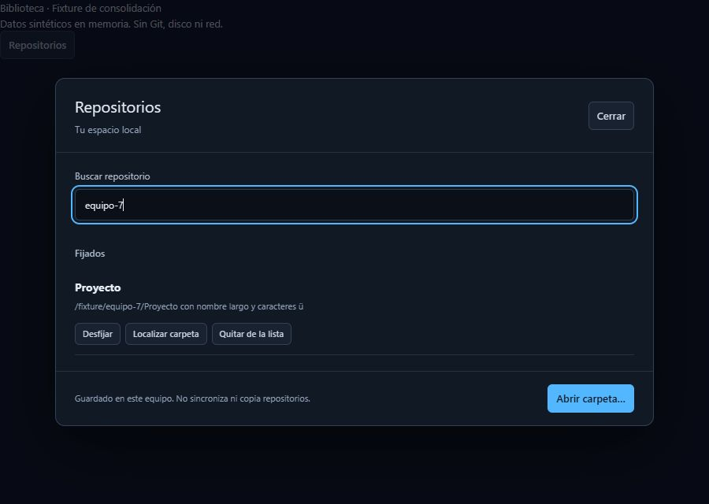

# Consolidación de biblioteca: recuperación y teclado

Fecha: 2026-10-22. Incremento A del roadmap, sobre `6533312` con cambios locales
en `LibraryDialog` y sus pruebas. No cierra A, RG-07 ni AC-08/11/12.

## Correcciones

- Una lectura fallida ofrece Reintentar lectura sin cerrar el diálogo ni abrir Git.
  No se sustituye una biblioteca ilegible por una vacía ni se sobrescribe su archivo.
- Fijar/desfijar conserva el foco en la acción de la misma entrada al cambiar de grupo.
- Quitar o cancelar su confirmación devuelve el foco a búsqueda; cerrar devuelve
  el foco al control que abrió el diálogo si sigue presente.
- Si el usuario continúa buscando durante un guardado, su foco no se roba al terminar.
  Las acciones mantienen el bloqueo de solicitudes simultáneas existente.

No cambia el esquema de almacenamiento, las preferencias, permisos ni comandos Git.
No se implementan aún las múltiples colecciones del incremento B.

## Evidencia automatizada y visual

Las nuevas regresiones reprodujeron primero la ausencia de reintento y la pérdida
de foco al fijar/quitar. Después de corregirlas: **115 pruebas de interfaz aprobadas
en 15 archivos**, incluidas **13 de LibraryDialog**. Cubren también varias entradas
homónimas con rutas distintas, grupos y orden, búsqueda por ubicación sin Git,
cancelación/fallo de relocalización, fallo de guardado y reintento sin duplicación.
TypeScript/Vite, Prettier y `git diff --check` aprobados; compilación nativa Windows
debug sin bundle aprobada (`npm run tauri build -- --debug --no-bundle`). Cargo
copió su caché incremental al no poder crear enlaces duros, sin impedir el build.
No se modifica Rust ni IPC; su suite completa aprobada
anteriormente se conserva en [el registro Windows](Windows_actual_2026-10-22.md),
sin presentarla como una nueva ejecución de este incremento.

Fixture reproducible: `npm run dev -- --port 1422`, abrir
`http://localhost:1422/dev/library.html?read-error`.
Ocho repositorios sintéticos en memoria; no lee ni escribe repositorios, disco,
credenciales ni red externa. `?save-error` rechaza una vez una edición de metadatos.
Otros comandos, incluido el selector de carpeta real, están deshabilitados.

Comprobación en navegador con la fixture:

1. Abrir Repositorios, observar fallo de lectura y reintentar; aparecen las entradas.
2. A 900 × 640, diálogo de 760 × 576 en (70,32), sin desbordamiento horizontal;
   búsqueda, lista desplazable, Cerrar y Abrir carpeta permanecen disponibles.
3. Buscar `equipo-7`, usar Tab y Enter para fijar; cambia a Fijados y el foco queda
   en Desfijar Proyecto, verificado en el árbol de accesibilidad.
4. Escape cierra y devuelve el foco a Repositorios; se comprobó tras corregir la
   pérdida de foco al desmontar el diálogo.
5. A 720 × 512 tampoco hay desbordamiento horizontal; la lista conserva scroll.
   Es una comprobación de espacio CSS reducido, no una certificación de escalado Windows.

La fixture no certifica persistencia tras reiniciar, permisos reales de disco,
lectores de pantalla, el WebView de Tauri ni la aplicación completa a ventana mínima.
No se extrapola esta revisión a macOS.

## Recorrido nativo pendiente para cerrar A

Usar repositorios desechables y la aplicación compilada; no el proyecto de desarrollo:

- Abrir al menos dos repositorios, fijar uno, buscar/reabrir y recorrer con Tab,
  Shift+Tab, Enter y Escape. Revisar ventana mínima y escalado del sistema.
- Guardar una referencia/filtro y búsqueda; esperar Preferencias guardadas, cerrar
  normalmente, abrir y comprobar restauración. Conservar el estado esperado de Git.
- Con la aplicación cerrada, mover sólo uno de los repositorios de prueba; abrir su
  entrada, comprobar el error y relocalizar. Reiniciar y verificar ruta, fijación,
  preferencias y nueva autorización independiente por ubicación, sin mover código
  desde RavenGit ni afectar la segunda entrada.
- Probar fallo de guardado en un perfil de prueba aislado, no alterando permisos
  del perfil habitual; comprobar aviso y reintento sin perder metadatos anteriores.
- Cherry-pick/revert con conflicto: cerrar normalmente, reabrir, resolver y continuar
  o abortar en fixtures separadas; verificar HEAD, árbol, registro y respaldo desde Git.

Registrar plataforma, versión, pasos y resultados. La falta de este recorrido
permanece explícita antes de dar por cerrado A y pasar a la aceptación de B.

## Seguimiento: cierre de cherry-pick/revert

El usuario informó que las demás comprobaciones funcionaban, pero no podía cerrar
el modal de cherry-pick. No se toma ese resumen como una matriz nativa detallada.
La integración tenía una clave React repetida: `ReplayDialog` y Cambios compartían
el ID del repositorio como clave entre hermanos. Se separó la identidad del modal.
Además, Cerrar/Escape cierran explícitamente el diálogo nativo antes de notificar
al padre, y el desmontaje usa el elemento capturado y restaura el foco de apertura.

Las regresiones comprueban cierre durante lectura, Escape sin abortar Git,
desmontaje real y reapertura desde Cherry-pick/Revertir commit, retorno de foco y
bloqueo temporal durante una solicitud activa. Cerrar el modal no aborta un conflicto
ni modifica commits; la recuperación continúa almacenada por Git. Falta confirmar
el cierre en el ejecutable corregido del usuario.

Resultado de esta corrección: **120 pruebas de interfaz aprobadas en 15 archivos**,
Prettier, `git diff --check`, TypeScript/Vite y build Windows debug sin bundle
aprobados. No se repitió Rust porque no cambió el backend. No se declara smoke nativo
del modal ni validación macOS por esta ejecución.
